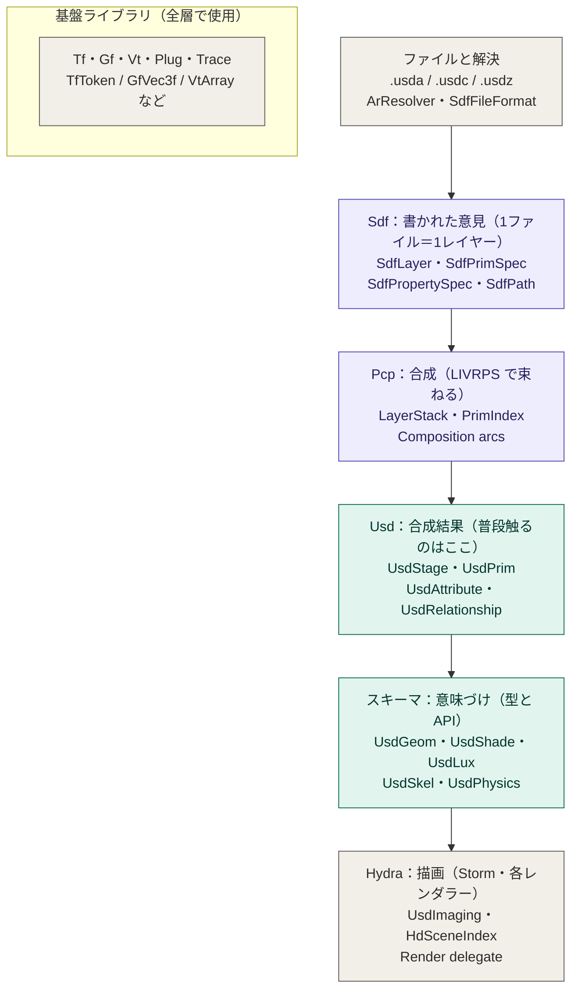

# USD の全体像：ライブラリの層

USD を体系化する軸は3つある。

1. ライブラリの層（このファイル）
2. 書かれたもの（Sdf）と合成結果（Usd）の区別 → `02_sdf-vs-usd.md`
3. スキーマの種類（IsA / API） → `03_schema-taxonomy.md`

## 層構造（上から下へデータが流れる）

凡例：紫＝書かれたデータと合成／緑＝合成後に触る API／灰＝周辺・基盤

## 流れの要約

- ファイルを `Ar` が見つけ、`Sdf` が読み込む
- `Pcp` が複数レイヤーを合成する
- その結果を `Usd` の API で触る
- スキーマが「これはメッシュ」「これはマテリアル」という意味を与える
- `Hydra` が描画する
- `Tf` / `Gf` / `Vt` はすべての層で使われる土台

## 層ごとの主要な固有名詞

| 層 | モジュール | 主な固有名詞 |
|---|---|---|
| ファイルと解決 | Ar, Sdf (FileFormat) | ArResolver, SdfFileFormat, .usda / .usdc / .usdz |
| 書かれた意見 | Sdf | SdfLayer, SdfPrimSpec, SdfPropertySpec, SdfAttributeSpec, SdfRelationshipSpec, SdfVariantSetSpec, SdfPath |
| 合成 | Pcp | LayerStack, PrimIndex, Composition arcs（sublayer / inherits / variantSets / references / payloads / specializes） |
| 合成結果 | Usd | UsdStage, UsdPrim, UsdProperty, UsdAttribute, UsdRelationship, UsdEditTarget |
| 意味づけ | UsdGeom, UsdShade, UsdLux, UsdSkel, UsdPhysics など | Xform, Scope, Mesh, Material, Shader, MaterialBindingAPI など |
| 描画 | UsdImaging, Hd | Hydra, Scene Index, Render delegate, Storm |
| 基盤 | Tf, Gf, Vt, Plug, Trace | TfToken, GfVec3f, GfMatrix4d, VtValue, VtArray |

## ノートの章立て案

1. 基盤型（Tf・Gf・Vt）
2. Sdf（Layer・Spec・Path）
3. 合成（Pcp・LIVRPS）
4. Usd（Stage・Prim・Property、値の解決順：default / timeSamples / value clips）
5. スキーマ（IsA/API × ドメイン）
6. モデル階層（kind・instancing）
7. Hydra
