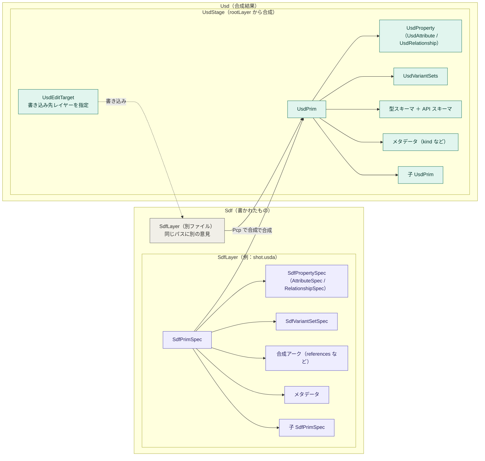

# Sdf（書かれたもの）と Usd（合成結果）

## 要点

- `SdfPrimSpec` はレイヤー（ファイル）側にある「1つのファイルに書かれた意見」
- `UsdPrim` は、複数レイヤーにある同じパスの PrimSpec を Pcp が重ね合わせた結果
- `SdfPropertySpec` は PrimSpec の中に入っている
- 「Prim の中に PrimSpec がある」のではなく、「Prim は複数の PrimSpec から合成される」

## 対応図



## 左右の対応表

| Sdf（書かれたもの） | Usd（合成結果） |
|---|---|
| SdfLayer | UsdStage（レイヤーの集まりを合成したもの） |
| SdfPrimSpec | UsdPrim |
| SdfPropertySpec | UsdProperty |
| SdfAttributeSpec | UsdAttribute |
| SdfRelationshipSpec | UsdRelationship |
| SdfVariantSetSpec | UsdVariantSets / UsdVariantSet |
| SdfPath | SdfPath（共通） |

## 押さえておくこと

- Sdf 側は「そのファイルに何が書かれているか」だけを扱い、レイヤーをまたいだ解釈はしない
- Usd 側は全レイヤーを合成した「最終的な見え方」
- `UsdAttribute.Set()` で値を書くと、実際には `UsdEditTarget` が指しているレイヤーの Spec が書き換わる
- 合成アーク（sublayer, inherits, variantSets, references, payloads, specializes）は PrimSpec に書かれ、Pcp が LIVRPS の強さ順に解決する

## 確認用コード（Python）

```python
from pxr import Usd, Sdf

stage = Usd.Stage.Open("shot.usda")
prim = stage.GetPrimAtPath("/World/Robot")

# この UsdPrim を構成している PrimSpec を強い順に列挙
for spec in prim.GetPrimStack():
    print(spec.layer.identifier, spec.path)

# 値がどこから来ているか
attr = prim.GetAttribute("xformOp:translate")
print(attr.GetResolveInfo().GetSource())

# 書き込み先レイヤーを切り替える（ステージのレイヤースタック内のレイヤーであること）
layer = Sdf.Layer.FindOrOpen("anim.usda")
stage.SetEditTarget(Usd.EditTarget(layer))
```
