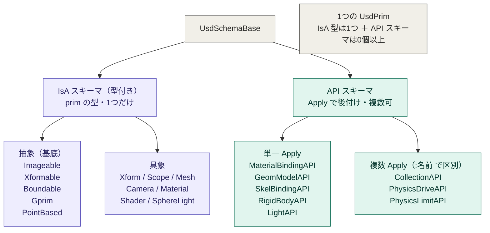
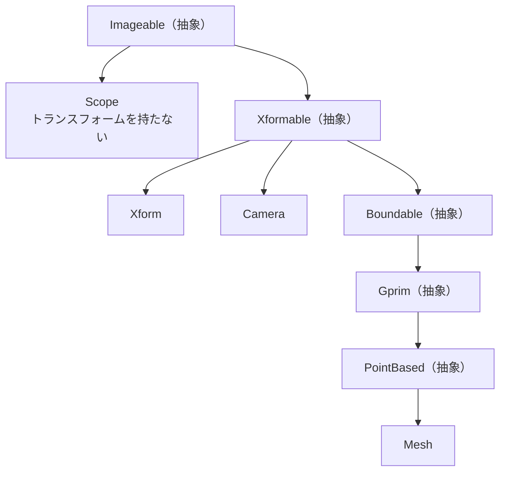

# スキーマの分類：IsA と API

## 要点

- `Xform` や `Scope` は API スキーマではなく IsA（型付き）スキーマ
- 「API」という言葉は二重の意味で使われる
  - プログラミング上の API（`UsdStage` などのクラス群）
  - prim に後から付ける「API スキーマ」

## 分類図



## UsdGeom の継承関係（Xform と Scope の違い）



- 抽象スキーマは直接 def できないが、継承元として機能を配る
- `Xform` も `Mesh` も `Xformable` を継承しているのでトランスフォームを持てる
- `Scope` は `Imageable` しか継承していないので、トランスフォームを持たない

## IsA と API の比較

| | IsA スキーマ | API スキーマ |
|---|---|---|
| 記録される場所 | prim の typeName | `apiSchemas` メタデータ |
| 1つの prim に | 1つだけ | 0個以上 |
| 書き方 | `def Xform "foo"` | `prepend apiSchemas = [...]` |
| 種類 | 抽象 / 具象 | 単一 Apply / 複数 Apply（ほかに非 Applied のヘルパーもある） |

## usda での例

```
def Xform "Robot" (
    prepend apiSchemas = ["MaterialBindingAPI", "CollectionAPI:lights"]
)
{
}
```

- IsA 型は `Xform`
- API スキーマは `MaterialBindingAPI`（単一）と `CollectionAPI:lights`（複数 Apply、インスタンス名 lights）

## もう1つの分類軸：ドメイン

スキーマは IsA / API とは別に、ドメインでも分類できる。

| ドメイン | IsA の例 | API の例 |
|---|---|---|
| UsdGeom | Xform, Scope, Mesh, Camera | GeomModelAPI, PrimvarsAPI |
| UsdShade | Material, Shader | MaterialBindingAPI |
| UsdLux | SphereLight, DomeLight | LightAPI, ShadowAPI |
| UsdSkel | SkelRoot, Skeleton | SkelBindingAPI |
| UsdPhysics | Scene, Joint | RigidBodyAPI, CollisionAPI, DriveAPI |
