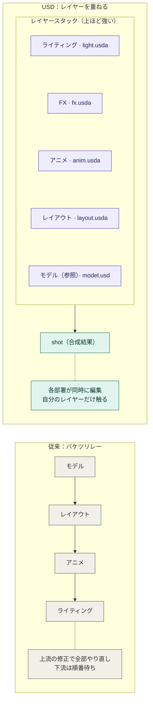

# 従来のパイプラインと USD のパイプライン

## 比較図



## 従来型

- 各部署が前の部署の出力（キャッシュ）を受け取り、自分の成果を焼き込んで次へ渡す
- モデルが1か所直るだけで、レイアウト以降が全部再出力になる
- 作業は直列になる

## USD 型

- 各部署が自分のレイヤーにだけ書く
- ショットはそれらを重ねた結果として、毎回その場で合成される
- モデルが更新されれば、参照している全ショットに次に開いた瞬間から反映される
- 誰も再出力する必要がない

## ショットのレイヤー構成の例

```
#usda 1.0
(
    subLayers = [
        @./light.usda@,
        @./fx.usda@,
        @./anim.usda@,
        @./layout.usda@
    ]
)
```

- subLayers は先に書いたものほど強い
- モデルは layout.usda の中から reference / payload で参照する
