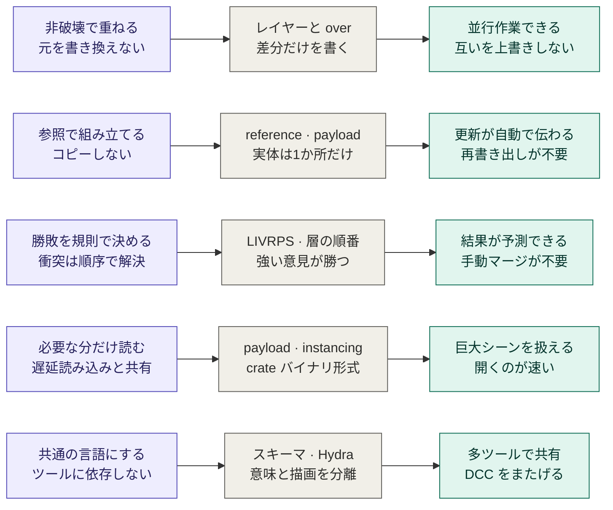

# USD の根本の考え方と強み

## 一言で

USD は「データを渡すフォーマット」ではなく、「大勢の意見を、壊さず、ルール通りに、必要な分だけ合成する仕組み」。

シーンを1つのファイルとして持つのではなく、たくさんの人の「意見（opinion）」を重ね合わせた結果として扱う。大規模チームや高頻度の更新に強いのは、すべてこの発想から来ている。

## 考え方 → 仕組み → 効く場面

| 根本の考え方 | USD の仕組み | 効く場面 |
|---|---|---|
| 非破壊で重ねる | レイヤーと over（差分だけを書く） | 並行作業できる |
| 参照で組み立てる | reference / payload（実体は1か所） | 更新が自動で伝わる |
| 勝敗を規則で決める | LIVRPS・レイヤーの順番 | 結果が予測できる |
| 必要な分だけ読む | payload・instancing・crate 形式 | 巨大シーンを扱える |
| 共通の言語にする | スキーマ・Hydra | 多ツールで共有できる |

## 大規模チームに効く理由

- 主に上の3つが効く
- 複数の人が同じものを触っても互いを上書きしない（非破壊）
- 衝突しても勝敗がルールで決まる（LIVRPS）
- そのため、調整の会議や手動マージが要らない

## 更新頻度の高さに効く理由

- 主に「参照で組み立てる」が効く
- 実体が1か所にしかないので、更新はそのファイルを書き換えるだけで済む
- 伝播は USD が自動でやる

## 追跡可能性を支えるもの

- Sdf（書かれたもの）と Usd（合成結果）が分かれている（`02_sdf-vs-usd.md`）
- 合成後の値を見ながらも、「この値はどの部署のどのレイヤーから来たか」を常に辿れる

## 弱い場面（強みの裏返し）

- 少人数で直列に作るだけなら、レイヤー設計のコストのほうが上回ることがある
- 意見が重なるほど、「なぜこの値なのか」のデバッグが難しくなる
- USD 自体はバージョン管理やアセット管理をしない
  - 「どのバージョンのファイルを指すか」は Asset Resolver と外部の管理システムに任せる設計
  - 実務ではここを含めたパイプライン設計が腕の見せどころ
