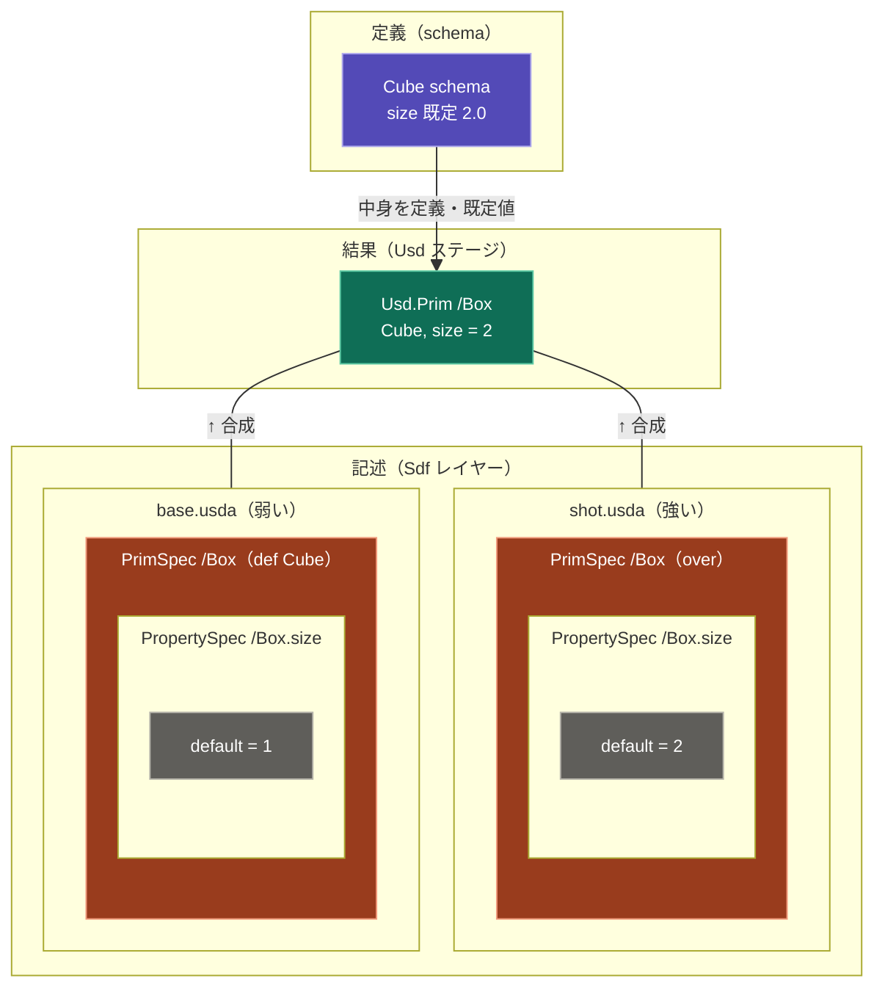

# USDのspecとschema

## まとめ

### spec
- 1つのレイヤーの中で、特定のパス（`/Box` や `/Box.size`）について書かれた記述のまとまり
- opinion を入れておく器
- コンポジションの材料の単位

### opinion
- spec の中に入っている1つ1つの値

### prim（Stage 上）
- 複数レイヤーの spec に入った opinion を、項目ごとに強い順で解決した結果

### schema
- 属性など prim の中身を定義するもの（Cube なら size を持つ、など）

### 横断：コンポジション
- コンポジションでは、各レイヤーの spec が重ねられ、opinion が項目ごとに解決されて prim になる
- references など「何をどう重ねるか」の指示も、spec の中に opinion として書かれる
- 合成される spec 同士のパスは同じとは限らない（reference では `/root/CubeA` と `/cube` のように別のパスの spec が1つの prim になる）

---

## 全体図

縦は抽象度（上ほど抽象、下ほど具体）、入れ子は包含関係（入れ物と中身）。合成は、各レイヤーの opinion を項目ごとに強い順で比べて Usd.Prim をつくる。



---

## なぜ必要か（ないとどうなるか）

USD は複数のレイヤーを重ねる前提で設計されている。VFX の現場では、1つの prim について複数部門がそれぞれ一部分だけを書く。

- モデル部：`model.usd` に `def Mesh "Box"` で形状を書く
- レイアウト部：`layout.usd` に `over "Box"` で位置だけ書く
- ライティング部：`light.usd` に `over "Box"` で表示設定だけ書く

もし「prim 全体を1か所に丸ごと定義する」しかなければ、各部門が同じ prim を奪い合って上書きすることになる。
spec は、この**部分的な記述をレイヤーごとに壊さず持っておくための単位**として必要になる。

---

## 2つの世界：Sdf と Usd

| 世界 | 何を扱うか | 開き方 | 登場するもの |
|---|---|---|---|
| Sdf（レイヤー） | 1つのファイルに書かれている記述そのもの | `Sdf.Layer.FindOrOpen()` | `Sdf.Layer`, `Sdf.PrimSpec`, `Sdf.PropertySpec` |
| Usd（ステージ） | ルートレイヤーと、そこからたどれるコンポジションをすべて合成した結果 | `Usd.Stage.Open()` | `Usd.Stage`, `Usd.Prim`, `Usd.Attribute` |

Usd.Prim は「spec の束を重ねて見た結果」、spec は「束を構成する1枚1枚」。

どちらも `ExportToString()` で中身を文字列にできるが、見えるものが違う。レイヤーからは**そのファイルに書かれた記述だけ**が見え、`references = @cube.usda@` と書いてあっても、合成後にどうなるかは分からない。ステージからは**合成済みの結果**が見える。

使い分け：合成後のシーンを扱いたい → `Usd.Stage`、特定のファイルに何が書いてあるかを知りたい・書き換えたい → `Sdf.Layer`。

---

## 用語の階層

| 用語 | 何か |
|---|---|
| layer | 1つのドキュメント（ファイル）。意見を持つ部分だけ書けばよい（sparse） |
| PrimSpec | あるレイヤー内の、あるパスの prim についての記述。specifier（`def` / `over` / `class`）、typeName、子の PrimSpec、PropertySpec、メタデータを持つ |
| PropertySpec | PrimSpec の下にぶら下がるプロパティの記述（AttributeSpec / RelationshipSpec）。型、デフォルト値、timeSamples、メタデータを持つ |
| opinion | spec の中の1つ1つの値。合成時に強さを比べる単位 |
| Usd.Prim | Stage 上で見える、合成済みの prim |
| schema | 属性など prim の中身を定義するもの（Cube、Mesh、Xform、Camera など）。どんな属性を持つか、その型を定める |

「prim という入れ物の中に property がある」というイメージは、**同じレイヤーの中では正しい**（`/Box.size` の PropertySpec は `/Box` の PrimSpec の下にある）。

PrimSpec と PropertySpec は、「**レイヤーの1つのパスに対する記述**」という点では同じ種類のもので、記述している対象が prim か property かが違うだけ。PrimSpec が上位なのは包含関係（入れ物と中身）の意味であって、抽象度が上という意味ではない。

---

## 例：項目ごとの解決

```usda
# base.usda
def Cube "Box" {
    double size = 1
}

# shot.usda（base.usda を sublayer）
over "Box" {
    double size = 2
}
```

- PrimSpec：2つ（base の `def`、shot の `over`）
- PropertySpec：2つ（`size = 1`、`size = 2`）
- Usd.Prim：1つ（`/Box`）

| 項目 | shot.usda（over・強い） | base.usda（def・弱い） | 結果 |
|---|---|---|---|
| typeName | 意見なし | Cube | **Cube** |
| size | 2 | 1 | **2** |

over は下のレイヤーを参照しているわけではない。合成は prim を丸ごと上書きするのではなく、**項目ごとに「意見を持っている中で一番強い spec」を探す**。空欄の項目は下の層の値が見える。透明なフィルムを重ねて、書き込みがある部分だけ上の層が勝つイメージ。

---

## 例2：reference ではパスが違ってもよい

```usda
# cube.usda
def Cube "cube" {
    int testValue = 10
}

# reference.usda
def Xform "root" {
    def "CubeA" (
        prepend references = @cube.usda@
    ) {
        int testValue = 100
    }
    def "CubeB" (
        prepend references = @cube.usda@
    ) {
    }
}
```

| Usd.Prim | 材料になる PrimSpec（強い順） | typeName | testValue |
|---|---|---|---|
| `/root/CubeA` | reference.usda `/root/CubeA` → cube.usda `/cube` | **Cube**（cube.usda から） | **100**（reference.usda から） |
| `/root/CubeB` | reference.usda `/root/CubeB` → cube.usda `/cube` | **Cube**（cube.usda から） | **10**（cube.usda から） |

- sublayer の例1では、どちらのレイヤーも `/Box` で同じパスだった。reference は「このパスに、あのファイルのあのパスの中身を持ってくる」という**パスの対応付け**をするので、`/root/CubeA` と `/cube` という別のパスの spec が1つの prim に合成される
- cube.usda の `/cube` という1つの PrimSpec が、CubeA と CubeB の両方の材料になっている
- `prepend references = @cube.usda@` 自体も、reference.usda の PrimSpec に書かれたメタデータ（opinion）。spec は材料であると同時に、「何をどう重ねるか」の指示書も兼ねる
- `def "CubeA"` には型が書かれていないが、typeName の opinion を持つ cube.usda から Cube が採用される

---

## spec と opinion の違い

- spec：opinion を入れる**器**
- opinion：その中の**1つ1つの値**（デフォルト値、timeSamples、各メタデータがそれぞれ別の opinion）

強さの比較は spec 単位ではなく opinion 単位で行われる。だから上の例のように、typeName は弱いレイヤーから、size は強いレイヤーから、という結果が起きる。
日常会話では「opinion がある」と「spec がある」はほぼ同じ意味で使われるが、解決の仕組みを考えるときは器と中身を分ける。

---

## spec と schema の違い

| | spec | schema |
|---|---|---|
| 何か | 誰が（どのレイヤーが）その prim について何を言ったかの記録 | 属性など prim の中身の定義 |
| 例 | `typeName = "Mesh"` という**文字列**を opinion として持つ | 「Mesh」が何を意味し、どんな属性を持つかを定める |
| 喩え | 発言の記録 | その言葉の辞書 |

schema が中身を埋めていることは、属性の取り方の違いで確かめられる。例2の CubeA で、

- `Usd.Prim` から `GetAttributes()` → `size`、`extent`、`visibility`、`xformOpOrder` など UsdGeomCube schema の属性と、書かれた `testValue` が**すべて**並ぶ
- `Sdf.PrimSpec` から `attributes` → そのレイヤーに書かれた `testValue` **だけ**

誰も `size` を書いていないのに prim が `size` を持つのは、schema が「Cube なら size を持つ」と定義し、どのレイヤーにも opinion がなければ既定値で埋めているから。

---

## Python で確認

```python
from pxr import Usd, Sdf

# レイヤー：そのファイルに書かれた記述だけ
layer = Sdf.Layer.FindOrOpen("reference.usda")
print(layer.ExportToString())

# ステージ：ルートレイヤー以下を合成した結果
stage = Usd.Stage.Open(layer)
print(stage.ExportToString())

# prim と spec で取れる属性の違い
prim = stage.GetPrimAtPath("/root/CubeA")
prim.GetAttributes()                     # schema の属性も含めてすべて
spec = layer.GetPrimAtPath("/root/CubeA")  # Sdf.PrimSpec
spec.attributes                          # このレイヤーに書かれた testValue だけ

# prim を構成する spec を強い順に
prim.GetPrimStack()                                 # Sdf.PrimSpec のリスト
prim.GetAttribute("testValue").GetPropertyStack()   # PropertySpec のリスト
```

コンポジションアークごとに、どのレイヤーのどの spec が材料になっているかは `Usd.PrimCompositionQuery` で調べられる。

```python
query = Usd.PrimCompositionQuery(prim)
for arc in query.GetCompositionArcs():
    node = arc.GetTargetNode()
    # ルートノードのレイヤースタックは先頭が匿名レイヤー（セッションレイヤー）なので2番目を使う
    lyr = node.layerStack.layers[1] if node.IsRootNode() else node.layerStack.layers[0]
    print(arc.GetArcType(), lyr.GetPrimAtPath(node.path))

# Pcp.ArcTypeRoot       → reference.usda の /root/CubeA
# Pcp.ArcTypeReference  → cube.usda の /cube
```

---

## 誤解しやすかった点

- ✕「spec は prim の役割を定義したもの」→ それは schema
- ✕「over が下のレイヤーの型を参照する」→ 項目ごとに、意見を持つ最も強い spec が採用されるだけ
- △「spec = opinion」→ ゆるく同一視してよいが、厳密には spec は器、opinion は中身
- ✕「合成される spec は同じパスにある」→ sublayer では同じだが、reference ではパスの対応付けが変わる

---

## 未解決の問い

- base.usda が存在せず、`over "Box" { double size = 2 }` だけが Stage にあったら `/Box` はどうなるか？

---

## 次に学ぶこと

- コンポジションアーク（LIVRPS）：sublayer 以外で spec の強さの順番がどう決まるか
- Sdf API：Houdini の Python LOP などで spec を直接書き換え、大量の prim を高速に処理する方法
- Pcp：`PrimCompositionQuery` の裏側で、コンポジションアークの構造をたどる仕組み

---

関連：[[USDのコンポジションとopinion]]
