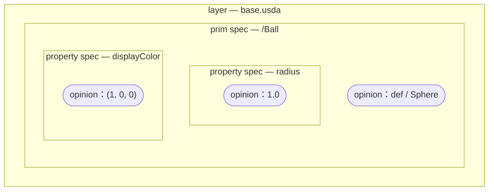

# USDのコンポジションとopinion

## 一言で

Stage上で見える prim は、どこかのファイルに書かれた実体ではなく、**複数のレイヤーに散らばった spec の中の opinion を、強さの順序で合成した結論**である。

---

## 用語の階層

| 用語 | 何か |
|---|---|
| layer | USD が読める1つのドキュメント（ファイル等）。中身は **sparse（疎）** で、意見を持つ部分だけ書けばよい |
| prim spec | あるレイヤーの中の「このパスの prim について何か書いている」記述のかたまり |
| property spec | prim spec の中のプロパティの記述（attribute spec / relationship spec） |
| opinion | spec の中に実際に書かれた値・設定。「こうあるべき」という主張 |
| prim | 合成された最終結果 |

- **書かれたもの**（authoring レベル）＝ layer / spec / opinion
- **合成された結果**（composed レベル）＝ prim

> spec は入れ物、opinion はその中身。
> 値だけでなく `def` などの specifier、型名、`kind` などのメタデータも opinion。

### 図式



```usda
def Sphere "Ball"                                  # prim spec（def / Sphere が opinion）
{
    double radius = 1.0                            # property spec（1.0 が opinion）
    color3f[] primvars:displayColor = [(1, 0, 0)]  # property spec（(1, 0, 0) が opinion）
}
```

- layer は prim spec を入れる入れ物、prim spec は property spec を入れる入れ物
- opinion は入れ物ではなく中身。property spec の値だけでなく、prim spec 自身も specifier や型名という opinion を持つ

---

## 具体例

```usda
# base.usda（モデラー）
def Sphere "Ball"
{
    double radius = 1.0
    color3f[] primvars:displayColor = [(1, 0, 0)]
}
```

```usda
# lighting.usda（ライティング）
over "Ball"
{
    double radius = 2.0
}
```

- `/Ball` に対して prim spec は **2つ**（`def ...` と `over ...`）
- `radius` に対して property spec は **2つ**、opinion は `1.0` と `2.0`
- `displayColor` は base.usda にしか opinion がないので、その値がそのまま通る

合成結果：

```usda
def Sphere "Ball"
{
    double radius = 2.0                            # lighting.usda が勝つ
    color3f[] primvars:displayColor = [(1, 0, 0)]  # base.usda から
}
```

---

## prim spec / property spec の詳細

### spec ＝ パスで指される「フィールドの集まり」

layer の中身は、パスをキーにした spec の集まり。各 spec は「フィールド名 → 値」の組を持っていて、書かれたフィールド1つ1つが opinion にあたる。

| spec | パスの例 |
|---|---|
| prim spec | `/Ball` |
| property spec | `/Ball.radius` |
| variant の中の prim spec | `/Ball{size=big}` |
| variant の中の property spec | `/Ball{size=big}.radius` |

`.` の後ろがプロパティ名、`{ }` は variant の中を表す。

### prim spec が持つ主なフィールド

| フィールド | usda での書き場所 | 例 |
|---|---|---|
| specifier | 先頭 | `def` / `over` / `class` |
| typeName | specifier の後 | `Sphere` |
| メタデータ | `( )` の中 | `kind`, `active`, `instanceable` |
| コンポジションアーク | `( )` の中 | `references`, `payload`, `inherits`, `specializes`, `variantSets`, `variants` |
| 子 prim・プロパティ | `{ }` の中 | 子の prim spec / property spec |

> コンポジションアークも prim spec のフィールド＝ opinion として書かれる。
> 「どこから opinion を持ってくるか」という指示そのものも、ある layer の opinion である。

### property spec が持つ主なフィールド

**attribute spec**

| フィールド | 意味 | 例 |
|---|---|---|
| typeName | 値の型 | `double`, `color3f[]` |
| default | 時間に依存しない値 | `= 1.0` |
| timeSamples | 時刻ごとの値（アニメーション） | `.timeSamples = { 1: 1.0, 24: 2.0 }` |
| variability | 時間で変化しうるか | `varying` / `uniform` |
| custom | スキーマにない独自の属性か | `custom double myValue` |
| connectionPaths | 他の attribute への接続 | シェーダーの入出力の接続 |
| メタデータ | 補足情報 | `interpolation` など |

**relationship spec**

| フィールド | 意味 | 例 |
|---|---|---|
| targetPaths | 他の prim / property へのパス | `rel material:binding = </Mat>` |

> 同じ attribute spec の中では、時刻を指定して値を取ると timeSamples が default より優先される。

### spec はあるが opinion（値）がない状態

```usda
over "Ball"
{
    double radius
}
```

- prim spec は存在するが、持っているのは specifier（`over`）だけ
- property spec は存在するが、型の宣言だけで値（default）がない
- 値の解決では値を持たない spec は飛ばされ、弱い layer の値が使われる

### specifier の解決

`over` は「上書きするだけ」なので、強い layer の `over` が弱い layer の `def` を打ち消すことはない。強い layer に `over`、弱い layer に `def` があれば、prim は `def` で定義されたものとして扱われる。

---

## つまずきポイント

- **USD は個々のファイルを1つにまとめるものだと思った** → ファイルは物理的には別のまま。Stage を開いた時点で合成された「見え方」が作られる。`flatten` で1ファイルに焼くこともできるが、それは書き出し用
- **「prim を編集する」と考えていた** → 実際は「特定のレイヤーに、その prim についての opinion を1つ書き足す」こと。どのレイヤーに書くかで結果と影響範囲が変わる

---

## 確認問題

> [!question]- `/Ball` が2つのレイヤーに書かれているとき、prim spec はいくつあり、prim はいくつあるか？
> > [!note]- 答え
> > prim spec は2つ（レイヤーごとに1つ）、合成された prim は1つ。

> [!question]- prim spec 自身が持つ opinion にはどんなものがあるか？
> > [!note]- 答え
> > `def` / `over` / `class` などの specifier、`Sphere` などの型名、`kind` などのメタデータ。

> [!question]- `over "Ball" { double radius }` だけが書かれた強い layer がある。radius の値はどうなるか？
> > [!note]- 答え
> > property spec はあるが値の opinion がないので飛ばされ、弱い layer の値が使われる。

> [!question]- コンポジションアーク（references など）は、どの spec のどこに書かれるか？
> > [!note]- 答え
> > prim spec のフィールドとして、usda では prim の `( )` の中に書かれる。アークの指定そのものも opinion。

---

参考：[Learn OpenUSD - Prim Composition](https://docs.nvidia.com/learn-openusd/latest/creating-composition-arcs/prim-composition.html)

関連：[[USDのコンポジションアーク]] / [[USDのAPI（Usd と Sdf）]] / [[USD Stage]] / [[Houdini Solaris]]
